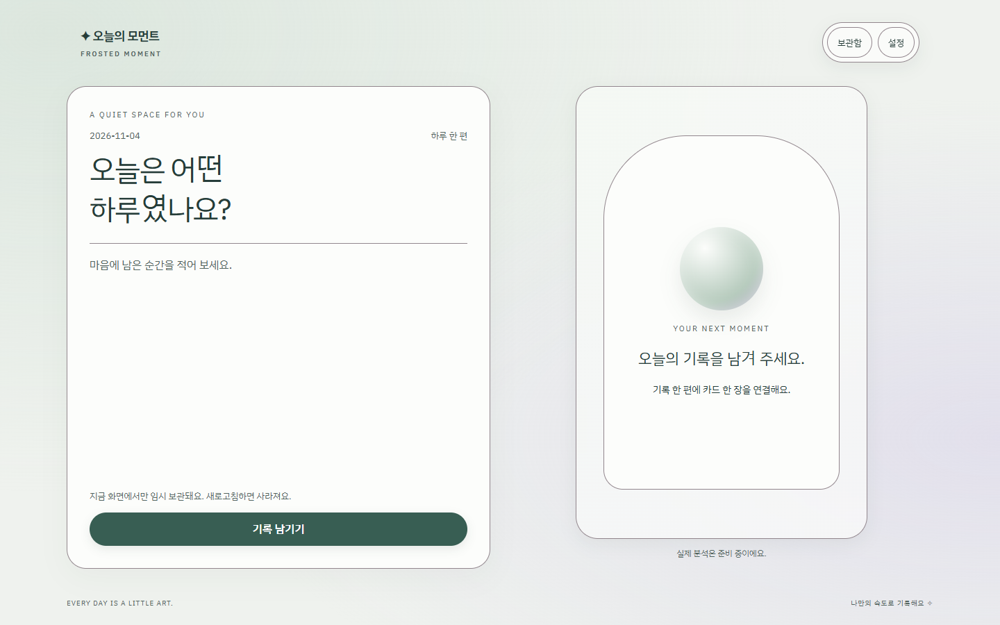
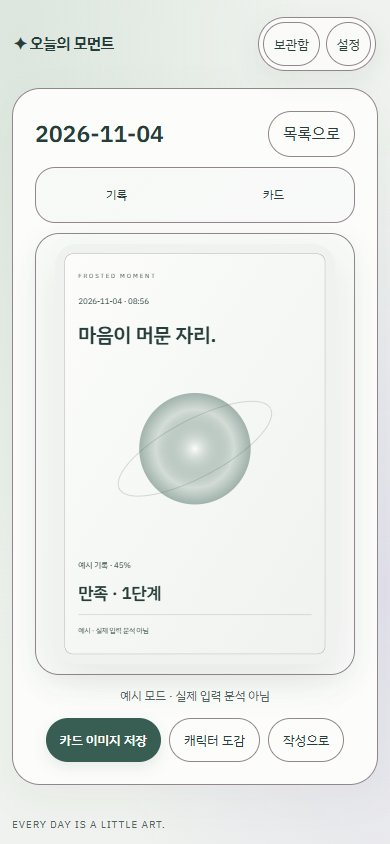

# Frosted Moment · 타깃 적합성 리뷰

2026-11-04 · 코드·Chrome 캡처 기반 전문가 평가입니다. 실제 타깃 인터뷰나 선호 조사는 하지 않았습니다. 아래 ‘판단’은 디자인 해석이며 소비자 조사 결과가 아닙니다.

## 후속 적용: 컴포넌트별 프로스트 재질

사용자 요청에 따라 캐릭터 디자인은 후속 작업으로 두고 유지했습니다. 초기의 헤더 전체 블러를 제거하고 탐색 버튼 묶음(10px, 표면 82%)과 카드 프레임(14px, 표면 84%)에만 블러를 적용했습니다. 입력·본문·카드 SVG는 변경하지 않았습니다. 따라서 이 변경으로 저장되는 카드 PNG의 디자인은 달라지지 않습니다.

탭은 얇은 테두리와 하이라이트, 선택 상태는 기존 강조색을 사용합니다. 설정 패널 외곽도 하이라이트만 적용해 내부 블러 중첩을 피했습니다. 카드 프레임은 불투명 패널 안에서 효과가 약해질 수 있어 옅은 정적 그라데이션을 함께 사용합니다. 효과 감소·OS 투명도 감소·강제 색상에서는 프로스트 배경과 블러를 해제합니다. 블러 미지원 시 불투명 표면이 기본입니다.

아래 평가는 초기 시안에 대한 판단을 바탕으로 하며 캡처는 후속 적용 상태로 갱신했습니다. ‘헤더의 깊이’는 이제 탐색 버튼 묶음의 깊이로 해석해야 합니다. 컴포넌트별 처리로 효과를 집중했지만 타깃 선호·수집 동기를 검증한 것은 아닙니다. 캐릭터 자산에 관한 한계는 후속 디자인 적용 때 다시 평가합니다.

## 결론: 디자인 실험으로 채택, 메인 전환은 보류

차분한 감정 기록을 원하는 사용자를 위한 후보로는 타당합니다. 그러나 **20~30대 여성의 취향을 저격했다고 말할 근거는 없습니다.** 연령·성별만으로 파스텔, 투명 재질, 자기 돌봄을 선호한다고 가정할 수 없습니다. 이번 디자인은 폭넓은 웰니스 인상을 얻는 대신 브랜드 고유성과 카드 수집의 재미를 일부 희생했습니다.

가장 큰 재사용 장애물은 재질보다 실제 분석 미연결과 새로고침 시 기록 소실입니다. 이는 두 화면에 공통인 기존 기능 제약이며 글래스 디자인의 결함으로 계산하면 안 됩니다. 다만 지금 제품을 계속 쓰고 싶은지 묻는다면 제약을 숨겨서는 안 됩니다.

## 실제 화면과 변경 근거

비교 기준은 메인 `frontend/index.html`의 기본 페이퍼 테마입니다. 원래의 따뜻한 종이색·보라색 주요 버튼·굵은 제목을 세이지 강조색·넓은 헤더·가벼운 제목·빛 번짐 배경으로 변경했습니다. 배치와 동작은 유지했지만 색·타이포·카드 장식도 달라졌으므로 결과를 ‘유리 효과 하나의 영향’으로 해석할 수는 없습니다.

Apple의 [재질 가이드](https://developer.apple.com/design/human-interface-guidelines/materials)는 유리 효과를 탐색·조작 영역에 절제해 쓰고 본문 계층과 구분하도록 권고합니다. 이 시안은 이를 참고한 CSS 프로스트 표현이며 Apple의 동적 굴절 재질을 재현한 것은 아닙니다. 플랫폼 채택 사례는 특정 성별의 선호나 시장 인기 순위를 증명하지 않습니다.

## 장점과 단점

| 관점 | 장점에 대한 판단 | 냉정한 한계와 비용 |
|---|---|---|
| 첫인상 | 회녹색·여백·둥근 형태가 조용한 개인 공간이라는 인상을 줌 | 흔한 웰니스·명상 서비스와 비슷함. 로고를 가리면 이 제품을 식별하기 어려움 |
| 글래스 표현 | 헤더에 깊이가 있고 본문과 탐색의 구분이 생김 | 정적인 화면에서 투명 효과가 약함. 강한 글래스 트렌드를 기대하면 ‘세이지 테마’로만 보일 수 있음 |
| 기록 집중 | 본문을 불투명에 가깝게 유지해 긴 글의 배경 간섭을 억제 | 가독성은 유리 효과보다 불투명 표면 덕분. 효과가 기록 품질을 높였다고 볼 근거는 없음 |
| 감정적 분위기 | 화려한 장식보다 기록 내용을 앞세움 | 밝고 장난스러운 수집 경험을 찾는 사용자에게는 심심하거나 차갑게 느껴질 가능성 |
| 카드 소장 | 같은 톤의 SVG와 PNG가 화면·출력의 일관성을 확보 | 감정별 색과 캐릭터 실루엣 차이가 부족하고 단계가 구 크기로만 달라짐. 서로 다른 카드를 모을 이유가 약함 |
| 모바일 | 핵심 버튼을 44px 이상으로 유지하고 작성/카드를 분리 | 작성 중에는 카드 장식이 보이지 않아 데스크톱보다 시각적 차별성이 작음 |
| 접근성 | 효과 감소·불투명 대체·밝고 어두운 모드를 제공 | 반투명 헤더의 전체 배경 조합과 실기기 저시력 사용성을 전수 검증하지 않음 |
| 성능 | 외부 이미지·폰트·애니메이션 요청 없음, 블러를 헤더에 제한 | 블러 합성 비용은 남음. Chrome 기능 통과가 저사양 폰의 프레임·배터리 검증을 뜻하지 않음 |

## 20~30대 여성: 사용 목적별 가설

다음 분류는 나이별 성격을 단정한 페르소나가 아니라 모집·분석 시 확인할 사용 목적입니다. 같은 사람도 여러 목적을 가질 수 있습니다.

| 목적 | 적합성 가설 | 확인해야 할 반증 |
|---|---|---|
| 짧게 감정 정리 | 조용한 표면과 하나의 주요 행동이 시작 부담을 줄일 가능성 | 첫 기록 시작 시간과 입력 포기율이 기존보다 나쁘다면 매력만 있는 디자인 |
| 카드 수집·꾸미기 | 차분한 취향이라면 저장 결과물을 좋아할 가능성 | 캐릭터별 차이를 못 느끼거나 ‘다 비슷하다’고 하면 수집 타깃에는 부적합 |
| 긴 글·회고 | 불투명 본문과 16px 입력 글자가 유리 | 실제 휴대폰에서 긴 글 수정·과거 기록 찾기에 피로가 늘면 부적합 |

20대 초반/후반/30대 집단의 관찰을 구분하되, 역할·기록 습관·디자인 취향을 함께 수집해야 합니다. 학생=20대, 직장인=30대라는 식으로 매핑하지 않습니다. 안정감·신뢰감은 화면 인상에 대한 가설이고 개인정보 보호의 실질적 증거가 아닙니다.

## 실제 타깃 검증용 과제지

한국어 사용자 여성 12명: 20~24·25~29·30~39세 각 4명. 각 연령에서 일기 경험자와 비경험자를 섞습니다. 6명은 메인 먼저, 6명은 신규 시안 먼저 보여줍니다. 설명·장치·글 길이·카드 상태를 동일하게 맞추고 실제 사적 내용 대신 제공된 가상 일기를 사용합니다.

1. 각 화면을 5초 보고 서비스의 목적과 기억나는 요소를 말하게 합니다. ‘여성스럽다’, ‘감성적이다’ 같은 답을 유도하지 않습니다.
2. 가상 일기 200자를 작성하고 한 문장을 수정합니다. 실제 저장 제약은 두 화면 모두 같은 시점에 안내합니다.
3. 설정의 예시 모드에서 지정 날짜의 기록을 찾아 카드를 PNG로 저장합니다. 실제 분석이 아닌 예시임을 이해했는지 확인합니다.
4. 가독성·집중도·소장 욕구를 각각 7점으로 평가하고 선택 이유를 묻습니다. ‘더 예쁘다’와 ‘매일 쓰기 편하다’를 별도로 묻습니다.

측정값: 도움 없이 완료한 인원, 완료 시간 중앙값, 오조작, 글자 읽기 어려움, 선호 이유, 기록 소실·분석 상태에 대한 오해. 전체와 목적별 관찰을 함께 남깁니다. 12명 결과로 모집단 비율이나 통계적 우위를 주장하지 않습니다.

실무 판단용 임시 기준: 10/12 이상 핵심 과제 완료, 기존 대비 시간 중앙값 10% 이상 악화 없음, 심각한 가독성 문제 없음일 때 다음 실험 후보로 유지합니다. 미적 선호가 높아도 사용성이 악화되면 수정합니다. 장기 재사용·유지율은 별도 장기 관찰 없이는 결론 내리지 않습니다. 이번 작업에서는 참가자 모집·실측을 수행하지 않았습니다.

NN/g의 [미적 사용성 효과 해설](https://www.nngroup.com/articles/aesthetic-usability-effect/)처럼 외형 호감이 사용성 문제를 가릴 수 있으므로 칭찬보다 실제 과제 수행을 우선합니다.

## 다음 판단

- 채택: 조용한 배경, 선명한 본문, 절제된 헤더 재질, 효과 감소 옵션.
- 수정 후보: 카드별 캐릭터 정체성, 모바일에서도 알아볼 수 있는 브랜드 디테일. 정식 캐릭터 자산은 이번 범위 밖입니다.
- 보류: 메인 테마 교체, ‘여성 선호 검증’ 마케팅, 유료 전환·유지율 개선 주장.
- 먼저 해결할 제품 과제: 분석과 영구 보관 정책. 재질 강화보다 서비스 약속과 실제 동작의 일치가 우선입니다.
