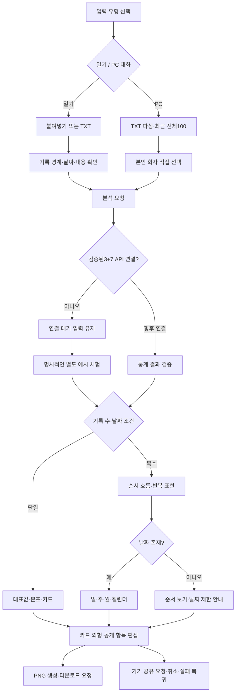

# SNS 일기 입력 SRS·SDS 개정 초안

2026-11-03 · **제안 상태**. 기존 SRS/SDS 및 학습 라벨을 확정·대체하지 않습니다.

## SRS 추가안

| 초안 ID | 요구사항 | 수용 기준 |
|---|---|---|
| D-FR01 | diary와conversation 입력 유형 분리 | 일기는 화자 단계 없음, PC는 직접 화자 선택 |
| D-FR02 | 붙여넣기와TXT 입력 | 같은 화면 전환·읽기 실패 시 기존 입력 유지 |
| D-FR03 | 기록 경계 명시 | 줄바꿈으로 임의 분리하지 않으며 사용자가 기록 추가·삭제 |
| D-FR04 | 미리보기·수정·삭제·범위 확인 | 정리 요소·분석 범위 확인 후 명시적 체크 |
| D-FR05 | 단일/복수/날짜 분기 | 단일 추이 금지·날짜없음은 순서 흐름 |
| D-FR06 | 3+7 계약 검증 |7ID·전체합1·부모합·독립argmax·결측구분 |
| D-FR07 | 공개 편집과PNG |1:1/4:5·2프레임·확률수치선택·설정과분석분리 |
| D-NFR01 | 개인정보 | 원문·이름·파일명·방명·내부ID 공유 제외. 원문 텔레메트리 금지 |
| D-NFR02 | 오류·독립 상태 | 원본 입력 유지·재시도·통계/설명/이미지 독립 |
| D-NFR03 | 모바일·접근성 |320/390/834/1440·표·계열명·focus·reduced-motion·AA 목표 |

초기 지원은 TXT UTF-8/EUC-KR입니다. PDF·DOCX·OCR·SNS URL 수집·자동 게시·누적 기록은 범위 밖입니다. 10,000자/30기록/1MB는 이번 프론트 검토용 제한이며 모델 한도로 확정하지 않습니다.

## 사용자 흐름



## SDS 데이터 계약 제안

기존PC: 비텍스트 제외→상대 포함 최근 전체100→대상 화자→최대3발화·stride1·첫anchor. 새 일기는 이 윈도우를 그대로 재사용하지 않습니다. **기록별 모델 적합성·긴 글 처리 승인 전까지 실제 추론 없음**.

제안 요청(실제 endpoint 미설정):

```json
{
  "schema_version": "diary-input-proposal-v1",
  "input_type": "diary",
  "records": [{"record_id":"record-1","order":1,"text":"사용자 원문","record_date":null}],
  "requested_taxonomy_ids":["pos_1","pos_2","pos_3","neg_1","neg_2","neg_3","neutral"]
}
```

UI는 requestDraft를 로컬에서 검증할 뿐 네트워크에 전송하지 않습니다. 확률·모델버전은 사용자 입력 단계에서 만들지 않습니다.

제안 응답 필수 항목: schema_version, input_type, taxonomy_version, model_version, analysis_status, records[{record_id,order,timestamp,status,leaf_probabilities,truncated}], narrative_status, image_status. 각 유효 record는7개 전체기준 확률을 하나만 갖습니다. 긴 글 분할 시 조각 개수로 원본 기록 가중치가 늘지 않도록 복원 규칙을 확정해야 합니다.

| 화면 | 원본/계산 | 분모·조건 |
|---|---|---|
| 입력 범위 | records·normalize·validate | 사용자가 확정한 기록 개수 |
|7분포 | 유효 원본record의P7 평균 | 유효 기록M |
|3분포 | 평균P7의자식합 | 같은M·전체확률 |
| 대표값 |P3 argmax/P7 argmax 각각 | 동률정보보존 |
| 흐름 |record.order·P7/P3 | 복수기록·Y0–100 |
| 기간 |유효timestamp에 bucketKey | 기간 내 원본record 평균 |
| 캘린더 |실제날짜그룹 | 결측날짜0대입금지 |
| 반복 |원본record ID Set의df / 총tf | ceil(.03N),최소2기록 |
| 설명 |검증된JSON의수치·항목 | 진단·원인·조언금지 |
| 공유 |publicPayload의허용목록 |원문데이터객체와분리 |

운영 응답 수용 전: 정확히7ID, 유한0~1, 합계허용오차1e-6, 부모합, 중복record, 요청범위일치, 잘린결과거절, 모델/분류버전, 오래된응답거절을 검증해야 합니다. 빈 결과·분석 불가·중립·날짜 없음은 분리합니다. 혼합 날짜는 날짜가 없는 기록의 제외수를 표시하고 입력 순서를 바꾸지 않습니다.

## 상태와 보관

입력: idle / reading / invalid / confirmed. 분석: ready / pending_connection(현재) / submitting·success·partial·error(향후). 통계·설명·이미지 상태를 분리합니다. 현재 API가 없으므로 가짜 진행률이나 완료 상태로 이어지지 않습니다.

공유: editing → generating → download_requested 또는 device_share_requested → cancelled/error. 운영체제 저장과 SNS 게시 결과는 추정하지 않습니다. 대기·오류 후 입력/설정을 보존합니다. 메모리만 사용하며 새로고침 시 사라집니다.

## UX 측정 설계

8개 과업: 붙여넣기→확인수정→요청→결과이해→편집진입→공개설정→저장/공유→오류복구. 진행자가 시작/완료 시간, 오류, 도움 요청, 중단 위치, 대표부모와최다자식 이해 여부를 기록합니다. 완료율·오류율·편집완료율·공유준비율·시간은 실제 시험 후 계산합니다. 현재 결과값은 없습니다. 원문을 자동 텔레메트리로 수집하지 않습니다.
