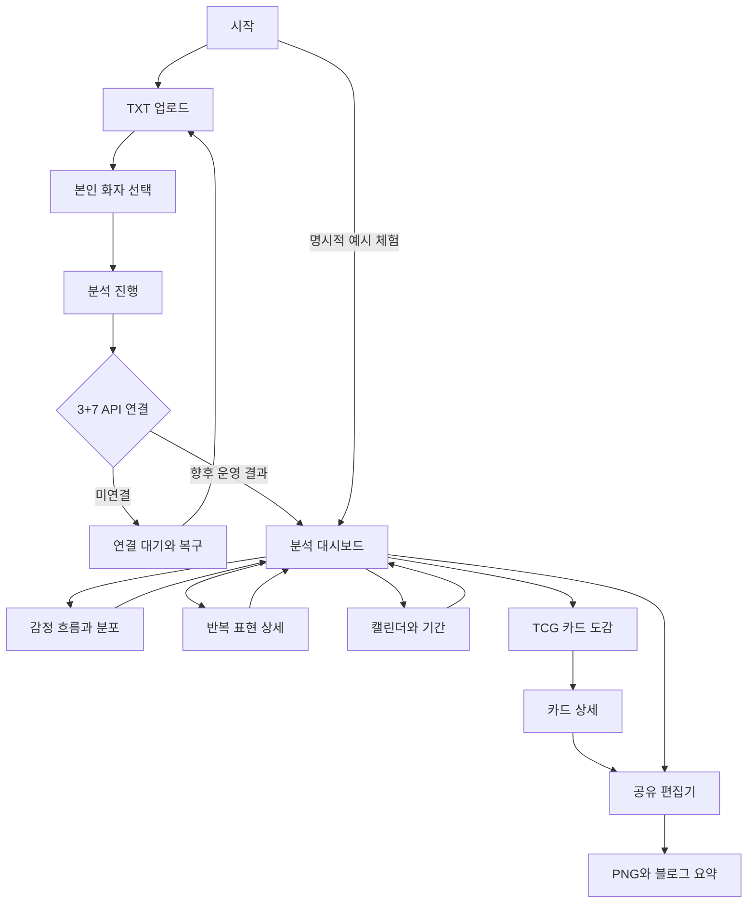
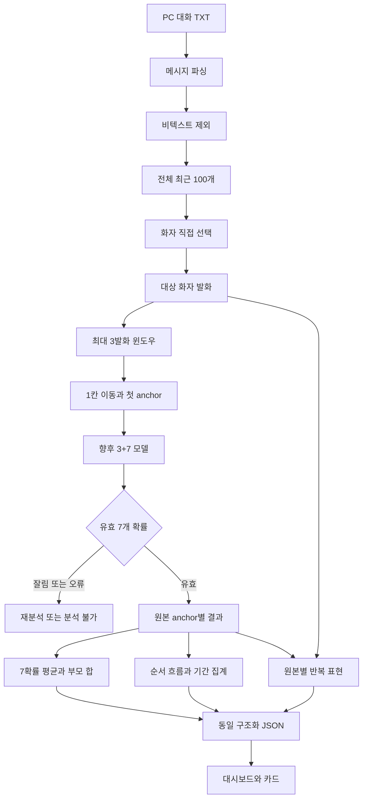
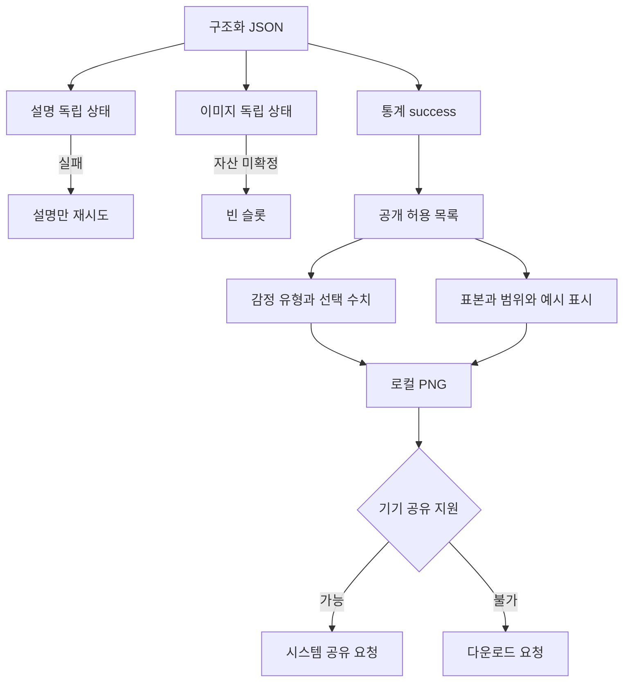

# 통합 서비스 구조와 데이터 흐름

개정일 2026-11-03. 다이어그램은 GitHub Markdown에서 시각적으로 렌더링됩니다. 운영 API는 설계 계약이며 현재 프론트엔드는 예시 결과 탐색과 로컬 파싱만 실행합니다.

## 서비스 사이트맵

## 분석 데이터 처리

## 부분 성공과 공유 경계

공유 허용 목록에는 이름·원문·파일명·대화방명·반복 표현·내부 분석 ID를 넣지 않습니다. PNG 생성, 다운로드 요청, 실제 갤러리 저장, SNS 게시 완료는 다른 상태입니다.
