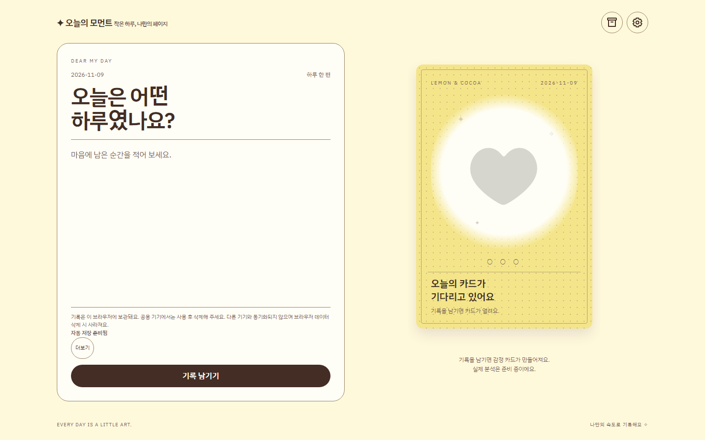
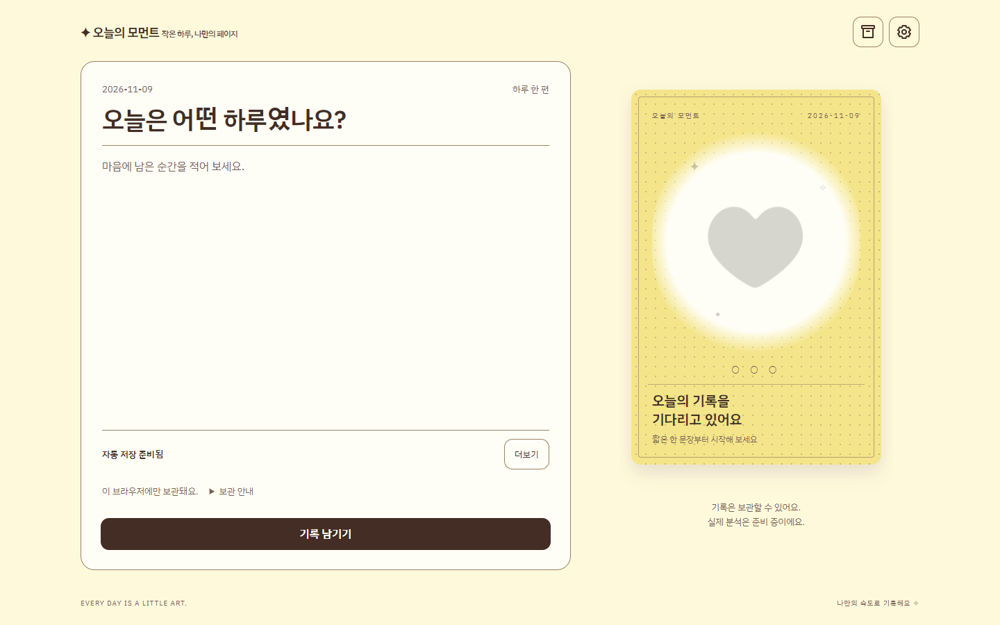
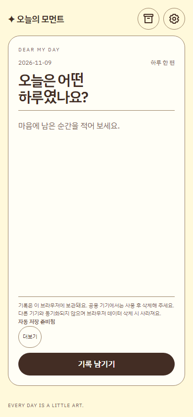
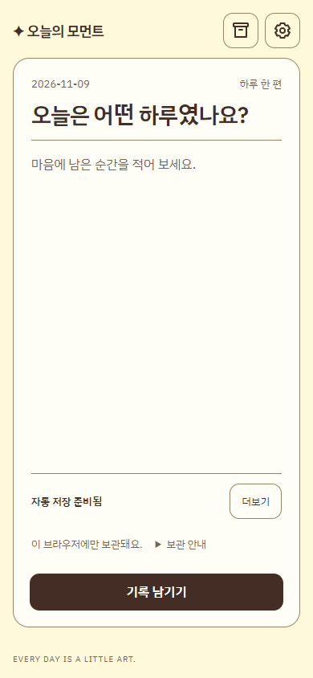
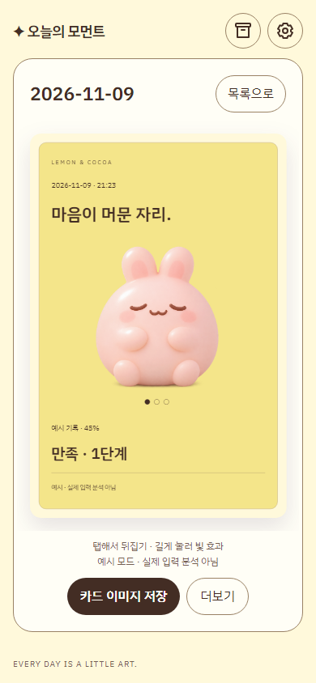
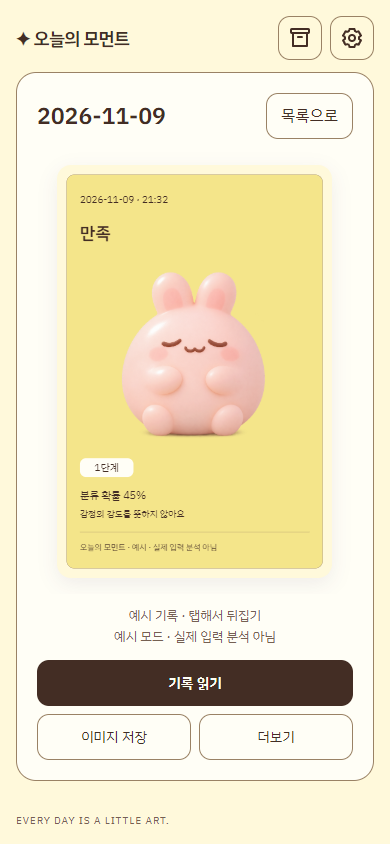

# 기록 중심 UI 개선 결과

2026-11-09 · 메인 frontend · Windows · Node v22.23.4 · Playwright 1.49.1 / bundled Chromium 1148.

## 변경 내용

- 작성 화면: 3:2 배치, 36px/28px 제목, 최소 180px 입력 영역, 저장 상태·보관 안내 분리. 작은 화면에서는 작성 내용만 스크롤하고 기록 버튼을 별도 하단 영역에 표시합니다.
- 카드: 날짜·감정명·기존 캐릭터·숫자 배지·분류 확률 순서. 기록 읽기를 직접 제공하며 모바일에서는 첫 행 전체 너비를 사용합니다. 저장 확인·실패·분석 준비 상태를 구별합니다.
- 보관함: 모든 너비에서 한 열, 원문 첫 줄 최대 2줄, 날짜·시각·상태와 48px 보조 썸네일.
- 돌아보기: 최초 월간 기록 선택, 탐색 중 선택 유지, 분석 없는 화면에서 지난 기록으로 이동.
- 도감: 완료율보다 연결 기록 중심 표현. 7종 캐릭터·21개 슬롯·단계 판정은 유지합니다.
- Lemon 패널 20px·버튼 12px 반경. 반복 반짝임 제거. 다른 테마와 카드 조작 효과는 유지합니다.

## 변경 전후

모든 이미지에는 예시 또는 검증용 합성 기록만 사용했습니다. `before-*`는 수정 전 앱에서 새로 캡처했습니다. 아래 `verified-rbmzeT`가 최종 소스의 증거이며 다른 verified 폴더는 수정 중 검증 이력입니다.

| 화면 | 변경 전 | 변경 후 |
|---|---|---|
| 데스크톱 작성 |  |  |
| 모바일 작성 |  |  |
| 모바일 카드 |  |  |

[320px 작성](verified-rbmzeT/write-small.png) · [보관함](verified-rbmzeT/archive-mobile.png) · [저장 실패](verified-rbmzeT/save-failed-mobile.png) · [내보낸 PNG](verified-rbmzeT/card.png)

## 실행한 검증

저장소 루트에서 실행했습니다. 시스템 Chrome 기본 경로에 실행 파일이 없어 기존 Playwright Chromium을 사용했습니다.

```powershell
$env:CARDEX_CHROMIUM = "$env:LOCALAPPDATA/ms-playwright/chromium-1148/chrome-win/chrome.exe"
node frontend/tools/build.mjs
node frontend/tools/build-wireframes.mjs
node frontend/tools/build-design-preview.mjs
node frontend/tools/build-tokens.mjs --check
node frontend/tools/build-design-preview.mjs --check
node --test frontend/tests/*.test.cjs
node frontend/tests/browser.cjs
node frontend/tests/persistence-browser.cjs
node frontend/tests/themes.cjs
node frontend/tests/card-effects.cjs
node frontend/tests/simplification.cjs
node frontend/tests/record-ui.cjs
node frontend/tests/wireframes.cjs
node frontend/tests/design-preview.cjs
git diff --check
```

| 검증 | 결과 |
|---|---|
| 빌드 및 생성물 일치 | 통과 |
| Node 단위 테스트 | 49개 통과 |
| 기본 브라우저 | 46개 검사, PNG 1080×1620, 런타임 오류·외부 요청 없음 |
| 영구 저장 | 저장·복원·수정·삭제·실패 재시도·충돌·손상·차단 통과 |
| 테마 | 6테마·12팔레트/PNG·5크기·시스템 모드 통과, 주요 텍스트 대비 4.5 이상 |
| 카드 효과 | 데스크톱/터치·키보드·동작 줄이기·공통 기하 통과 |
| 조작과 배치 | 72 테마/뷰포트 조합, 3개 기본 동작, 삭제 취소·수정 취소 통과 |
| 기록 중심 UI | 저장 실패 시 성공 표시 금지·재시도·읽기 후 초점 복귀·월간 기본값·선택 유지·10,000자·PNG 통과 |
| 와이어프레임 | 52개 SVG, 탐색·3크기 통과; 직접 읽기 링크와 화면 정의 일치 |
| 디자인 검토 페이지 | 12팔레트×3너비, 오프라인·링크 통과 |

작성·카드·보관함·실패 화면과 PNG를 직접 열어 시각 검토했습니다. 카드 이미지에는 원문을 넣지 않습니다.

## 제한과 후속 확인

- 200%는 읽기 대화상자의 CSS 확대와 스크롤·닫기 접근을 자동 확인했습니다. 브라우저 자체 200% 확대와 전체 화면 재배치는 별도 수동 검증이 필요합니다.
- 실제 모바일 키보드, Safari/Firefox, 한국어 스크린리더는 미검증입니다.
- 타깃 사용자 선호·재사용률은 조사하지 않았습니다. 감정 분석 API 연결은 이번 범위가 아닙니다.
- 기존 파일과 생성 도구의 출력은 변경 전에 `.backups/`로 버전 백업하고 해시 일치를 확인했습니다. `index.html`은 공식 빌드로 생성했습니다.
